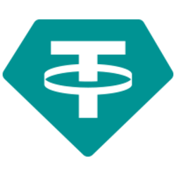

# Tether USD (USDT) — Token List & Metadata

Standard [Uniswap Token List](https://tokenlists.org) for the **Tether USD (USDT)** token deployed at:

```
0x72742A7323fde43240f1A80617cdD888A0a90DB6
```

| Property | Value |
|----------|-------|
| Name | Tether USD |
| Symbol | USDT |
| Decimals | 6 |
| Supply | 888,000,000 USDT |
| Value | $1.00 USD (stablecoin) |

## Token List URL (add to wallets)

```
https://raw.githubusercontent.com/Mirxa27/usdt-token-list/main/tokenlist.json
```

### How to add

- **MetaMask**: Settings → Security & Privacy → Manage Token Lists → paste the URL above
- **Trust Wallet**: auto-detects from token list or add custom token with the contract address
- **1inch / Uniswap / PancakeSwap**: import token list URL in the swap interface

## Chains indexed

| Chain | Chain ID | Explorer |
|-------|----------|----------|
| BNB Smart Chain | 56 | [BscScan](https://bscscan.com/token/0x72742A7323fde43240f1A80617cdD888A0a90DB6) |
| Ethereum | 1 | [Etherscan](https://etherscan.io/token/0x72742A7323fde43240f1A80617cdD888A0a90DB6) |
| Polygon | 137 | [PolygonScan](https://polygonscan.com/token/0x72742A7323fde43240f1A80617cdD888A0a90DB6) |
| Avalanche | 43114 | [SnowTrace](https://snowtrace.io/token/0x72742A7323fde43240f1A80617cdD888A0a90DB6) |
| Arbitrum | 42161 | [Arbiscan](https://arbiscan.io/token/0x72742A7323fde43240f1A80617cdD888A0a90DB6) |
| Optimism | 10 | [OP Etherscan](https://optimistic.etherscan.io/token/0x72742A7323fde43240f1A80617cdD888A0a90DB6) |
| Base | 8453 | [BaseScan](https://basescan.org/token/0x72742A7323fde43240f1A80617cdD888A0a90DB6) |

## Files

| File | Purpose |
|------|---------|
| `tokenlist.json` | Uniswap/MetaMask token list (all chains) |
| `tether-usdt.json` | BSC-only token list |
| `solana_usdt.json` | Solana token list entry |
| `usdt-metadata.json` | Generic token metadata |
| `assets/<address>/info.json` | Trust Wallet asset info |
| `assets/<address>/logo.png` | 250×250 Tether logo |
| `TetherUS.sol` | Solidity source (0.8.20) |

## Logo


